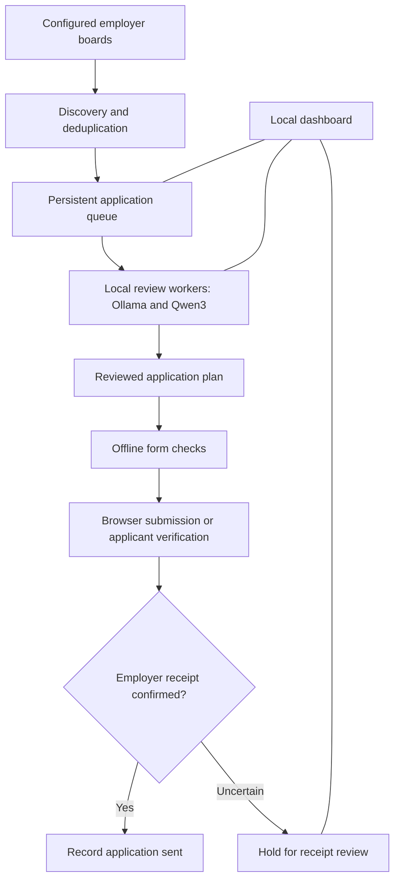

# Ronald Catibag | Roleflow

**Senior Site Reliability Engineer | DevOps & AI Platform Engineering**

I'm Ronald Catibag, a Site Reliability Engineer based in the Philippines. My work spans cloud infrastructure, Kubernetes, infrastructure as code, incident response and observability. I also build practical AI workflows using local models, MCP integrations and RAG for operational knowledge retrieval.

Roleflow is my personal engineering project: a local workspace for discovering jobs, reviewing opportunities, preparing application materials and tracking submission outcomes. It brings together my SRE background and my work in applied AI.

[GitHub](https://github.com/RonaldCatibag) | [LinkedIn](https://www.linkedin.com/in/catibag-ronald/)


## What I built

I extended an existing job-search framework with a local application platform and its supporting runtime.

| Area | My work in Roleflow |
| --- | --- |
| Application controller | Python backend with durable SQLite queues, task stages, bounded retries and recovery after interruption. |
| Local AI workers | Researcher, tailorer and checker roles using Ollama and Qwen3, with one inference slot to manage workstation memory. |
| Application dashboard | A browser interface for application progress, pending work, agent activity, system health and saved email signals. |
| Job discovery | A separate worker that scans configured employer boards, saves evidence, deduplicates results and queues opportunities for review. |
| Form adapters | Reviewed-plan workflows for Greenhouse, Lever and Ashby, with offline checks and verification handoffs. |
| Submission evidence | Employer-response tracking and receipt validation before recording an application as sent. |
| Runtime operations | Start/stop scripts, systemd service templates, resource limits and shutdown handoffs that preserve pending work. |

## Why this project matters to me

I wanted to apply the same discipline I use in infrastructure operations to an AI-assisted workflow: explicit state, reproducible evidence, controlled side effects and useful monitoring.

The engineering work goes beyond prompting a model. The controller owns the queue, deterministic code handles discovery and validation, and local models help review the evidence. An uncertain submission remains visible until its outcome is reconciled.

This is also how I am developing my AI engineering skills: integrating local inference into an application, coordinating specialized workers, grounding generated material in confirmed facts and keeping the workflow observable.

## How it works



## Technology

- **Backend:** Python and SQLite.
- **Local inference:** Ollama and Qwen3.
- **Frontend:** HTML, CSS and JavaScript.
- **Browser workflows:** Playwright and Chromium.
- **Operations:** Linux/WSL, systemd user services, resource limits and persisted task logs.
- **Document generation:** ReportLab and PyMuPDF, with text, page-count and layout checks.

MCP and RAG are part of my broader AI-assisted operations work. The local review path in this repository currently uses the Ollama HTTP API.

## Current scope

Roleflow is a personal workstation project. Discovery covers configured sources, and each application adapter depends on the employer's current form. CAPTCHA challenges and other applicant-only verification steps require the applicant's own action.

Email signals in the dashboard are saved snapshots; the dashboard does not independently poll the mailbox. Model output does not establish work authorization, invent experience or prove an application was submitted.

The dashboard is intended for **localhost**, not deployment as a shared public service. Publishing this repository shares its source code; it does not share my running dashboard, mailbox or application queue.

## Explore the code

| Path | Purpose |
| --- | --- |
| [`tools/application_controller.py`](tools/application_controller.py) | Persistent workflow and submission state. |
| [`tools/local_application_agents.py`](tools/local_application_agents.py) | Local review workers. |
| [`tools/application_tracker.py`](tools/application_tracker.py) | Dashboard API and tracker storage. |
| [`frontend/application-tracker/`](frontend/application-tracker/) | Browser interface. |
| [`tools/lever_application_runner.py`](tools/lever_application_runner.py) | Lever form workflow and receipt checks. |
| [`runtime/local-ai/`](runtime/local-ai/) | Companion runtime and service source. |
| [`ROLEFLOW.md`](ROLEFLOW.md) | Local configuration and runtime notes. |

## Local setup

```bash
git clone https://github.com/RonaldCatibag/ai-job-search.git
cd ai-job-search
python3 tools/init_local_profile.py
```

The initializer creates missing local configuration from safe templates and preserves existing files. Full operation also requires the Python/browser dependencies, Ollama, a local model and reviewed local configuration; the repository is a source backup rather than a one-command installer.

On my configured workstation, I use:

```bash
~/local-ai/start-roleflow
~/local-ai/stop-roleflow
```

See [`ROLEFLOW.md`](ROLEFLOW.md) and [`runtime/local-ai/START_STOP.md`](runtime/local-ai/START_STOP.md) for details. Personal profiles, resumes, application records, browser state, credentials and runtime logs are excluded from version control.

## Background and attribution

Roleflow builds on the [AI Job Search framework](https://github.com/ai-job-search-dev/ai-job-search). My additions focus on the local dashboard, application controller, model workers, ATS adapters, runtime operations and evidence tracking. The upstream history and [MIT license](LICENSE) are retained.
